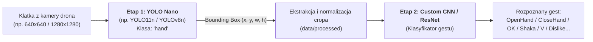

# 🚁 Thesis Dataset Automation & Pipeline

System wersjonowania danych, automatycznej detekcji rąk i przygotowywania zbioru danych pod pracę inżynierską (gesty dłoni z drona).

---

> 📖 **Szczegółowa Dokumentacja:** Kompletne przewodniki krok po kroku, instrukcje kooperacji oraz opis powstawania zbiorów treningowych znajdują się w katalogu [**docs/**](file:///Users/michalskoczylas/Documents/studia/thesis/dane/docs/README.md).

---

## 🧠 Architektura Systemu: Dwustopniowy Detektor Gestów

Projekt opiera się na **architekturze dwustopniowej (Two-Stage Detection & Classification)**, zoptymalizowanej pod kątem urządzeń brzegowych (Edge AI / dron):



### Dlaczego podejście dwustopniowe?
1. **Etap 1 (Lokalizacja dłoni):** Wykorzystuje lekki model **YOLO Nano** (1 klasa: `hand`). Dłoń w kadrze z drona może być mała i oddalona (1.4m – 2.0m). Zadaniem YOLO jest wyłącznie szybkie i niezawodne wskazanie, gdzie znajduje się dłoń człowieka, niezależnie od układu palców.
2. **Etap 2 (Klasyfikacja gestu):** Wycięty fragment dłoni (`crop`) trafia do **customowej sieci CNN** lub **ResNet/MobileNet**, wytrenowanej wyłącznie na wycinkach z `data/processed`. Pozwala to skupić całą pojemność klasyfikatora na drobnych detalach palców i dłoni bez marnowania parametrów na tło kadru.
3. **Wydajność na dronie:** Pozwala na pracę w czasie rzeczywistym (wysoki FPS), elastyczną wymianę klasyfikatora oraz niezależną ewaluację obu komponentów w pracy dyplomowej.

---

## ⚡ Szybki start na nowym urządzeniu

Klonowanie i przygotowanie środowiska zajmuje 2 minuty:

```bash
# 1. Klonowanie repozytorium
git clone <url_repozytorium>
cd dane

# 2. Utworzenie pliku konfiguracji środowiska
make setup
# Uzupełnij token w pliku .env (LABEL_STUDIO_TOKEN=...)

# 3. Zainstalowanie zależności Pythona
pip install -r requirements.txt

# 4. Pobranie danych z Google Drive (DVC)
make pull

# 5. Uruchomienie Label Studio (w tle)
make ls-up
```

Label Studio będzie dostępne pod adresem: [http://localhost:8081](http://localhost:8081).

---

## 🔄 Przepływ pracy (Pipeline)

Pełny proces przygotowania danych od surowych serii klatek z drona po gotowy dataset:

```
[Surowe klatki z drona] (np. data/source_frames lub katalog zewnętrzny)
        │
        ▼  make sample (bierz co N-tą klatkę, domyślnie stride=10)
   [data/raw] (wyselekcjonowane, unikalne klatki do datasetu)
        │
   ┌────┴──────────────────────────────────────────┐
   ▼                                               ▼
Wariant 1: STANDARDOWY                     Wariant 2: AI UPSCALED
(make pipeline-standard)                   (make pipeline-upscaled)
   │                                               │
   ▼ make detect                                   ▼ make upscale
[data/labeled]                             [data/raw_upscaled] (1280x1280)
   │                                               │
   ▼ make import-ls -> UI -> export-ls             ▼ make detect-upscaled
[data/annotations/dataset.json]            [data/labeled_upscaled]
   │                                               │
   ▼ make crop                                     ▼ make crop-upscaled
[data/processed] (cropy dłoni)             [data/processed_upscaled] (cropy AI)
```

---

## 🎞️ Krok 0: Próbkowanie klatek z drona (Frame Subsampling)

Kamery dronów rejestrują wideo z prędkością 12, 30 lub 60 kl./s, generując w każdej sesji dwa podfoldery:
- `camera_rgb` (obraz barwny)
- `camera_raw` (surowy bufor sensora z mozaiką Bayera)

Skrypt `scripts/sample_frames.py` pozwala wybrać **konkretną kamerę** (domyślnie `camera_rgb`) i pobrać **co N-tą klatkę** (np. co 10.), całkowicie pomijając klatki z drugiej kamery (brak duplikatów):

### 1. Szybki podgląd (symulacja bez zapisywania plików):
```bash
make sample-dry-run INPUT=/sciezka/do/klatek CAMERA=camera_rgb STRIDE=10
```

### 2. Wykonanie próbkowania do `data/raw`:
```bash
# Z domyślnymi parametrami z params.yaml:
make sample INPUT=/sciezka/do/klatek

# Z wyborem kamery i własnym krokiem:
make sample INPUT=/sciezka/do/klatek CAMERA=camera_rgb STRIDE=10

# Próbkowanie z automatyczną konwersją do czystego czarno-białego w locie:
make sample INPUT=/sciezka/do/klatek CAMERA=camera_rgb STRIDE=10 TO_GRAY=1
```

### 3. Zaawansowane opcje przez skrypt Pythona:
```bash
# Podstawowe z wyborem kamery:
python3 scripts/sample_frames.py --input /sciezka/do/klatek --output data/raw --camera camera_rgb --stride 10

# Oszczędność dysku (tworzy dowiązania symboliczne zamiast kopii plików):
python3 scripts/sample_frames.py --input /sciezka/do/klatek --output data/raw --camera camera_rgb --stride 10 --symlink

# Wyczyszczenie data/raw przed próbkowaniem nowej partii:
python3 scripts/sample_frames.py --input /sciezka/do/klatek --output data/raw --camera camera_rgb --stride 10 --clear
```

> [!TIP]
> **Automatyczne czyszczenie ścieżek:**
> Skrypt automatycznie usuwa zbędny poziom podfolderu `camera_rgb/` z katalogu docelowego, dzięki czemu w `data/raw/` klatki lądują bezpośrednio pod folderem danej sesji (np. `1_4metra/closehand/2026-10-15-14-45-08/00040.jpg`).

---

## 📸 Krok 0.5: Normalizacja do czarno-białego (Usuwanie kropek i konwersja RGB)

Kamery dronów mogą generować dwa rodzaje plików:
1. **RAW z czarnymi kropkami (`camera_raw`):** Surowa mozaika filtrów Bayera (CFA) zapisana jako monochrom. Powoduje efekt czarnego rastru/kropek i drastycznie psuje ostrość.
2. **Kolorowe RGB (`camera_rgb`):** Klatki z silnym zielono-niebieskim zafarbem w sztucznym oświetleniu.

Skrypt `scripts/convert_grayscale.py` automatycznie rozpoznaje format każdego pliku:
- Dla **RAW**: wykonuje debayering (`COLOR_BayerRG2GRAY`), który **całkowicie usuwa czarne kropki** i przywraca gładką, pełną rozdzielczość.
- Dla **RGB**: konwertuje na czysty monochromatyczny obraz.
- Zachowuje pełną strukturę podfolderów i zapisuje obrazy jako 3-kanałowe ($R=G=B$), kompatybilne z YOLO/DINO.

### Uruchomienie:
```bash
# Konwersja w miejscu (nadpisuje pliki w data/raw czystym czarno-białym bez kropek):
make to-gray-inplace INPUT=data/raw

# Lub zapis do nowego folderu:
make to-gray INPUT=data/raw OUTPUT=data/raw_clean
```

---

## 🛠️ Dostępne polecenia (Makefile)

Wszystkie operacje wykonasz jednym poleceniem:

| Polecenie | Opis |
|-----------|------|
| `make help` | Wyświetla listę wszystkich dostępnych poleceń |
| `make sample` | Próbkuje klatki z drona (co N-tą klatkę, domyślnie z `params.yaml`) |
| `make sample-dry-run` | Symulacja próbkowania (podgląd w terminalu bez kopiowania plików) |
| `make to-gray-inplace` | Konwertuje na czarno-biały w miejscu (usuwa czarne kropki i zafarb RGB) |
| `make to-gray` | Konwertuje do nowego folderu (`INPUT=... OUTPUT=...`) |
| `make detect` | Wykrywa dlonie (Grounding DINO / auto przełączenie na YOLO) |
| `make detect-yolo` | Szybka autodetekcja wytrenowanym modelem YOLO (50-100 FPS) |
| `make crop` | Wytnij wycinki dloni -> data/processed |
| `make pipeline-standard` | Uruchamia pełny potok standardowy (`detect` $\to$ `crop`) |
| `make pipeline-upscaled` | Uruchamia pełny potok AI (`upscale` $\to$ `detect_upscaled` $\to$ `crop_upscaled`) |
| `make pipeline-all` | Przelicza oba potoki równolegle w DVC |
| `make upscale-benchmark` | Szybki test FPS i czasu inferencji upscalingu na Apple Silicon |
| `make ls-up` | Uruchamia Label Studio w Dockerze (port 8081) |
| `make ls-down` | Zatrzymuje Label Studio |
| `make import-ls` | Importuje wykryte ramki i zdjęcia do Label Studio (Projekt 1) |
| `make import-ls-coop` | Dzieli klatki 50/50 na 2 osobne projekty dla 2 osób (Michał i Kolega) |
| `make export-ls` | Pobiera zatwierdzone przez człowieka adnotacje do JSON |
| `make prepare-yolo` | Przygotowuje dane pod YOLO (Etap 1) oraz Custom CNN (Etap 2) |
| `make prepare-yolo-zip` | Przygotowuje dane i pakuje do ZIP (pod Colab) |
| `make train-yolo` | Rozpoczyna trening YOLO Nano (RTX CUDA / Apple Silicon MPS / CPU) |
| `make pull` | Pobiera najnowszy zbiór danych z Google Drive (`dvc pull`) |
| `make push` | Wysyła wygenerowane dane na Google Drive (`dvc push`) |
| `make status` | Pokazuje status potoków oraz danych DVC |

---

## 📦 Wersjonowanie danych (DVC)

Zbiory danych są wersjonowane przez **DVC** i powiązane z commitami w **Git**:
* `data/raw.dvc` – wersjonuje oryginalne klatki z drona.
* `dvc.lock` – automatycznie blokuje i wersjonuje:
  * `data/raw`
  * `data/labeled` (predykcje)
  * `data/processed` (wycięte dłonie)
  * kod skryptów oraz parametry z `params.yaml`

Gdy wygenerujesz nową wersję zbioru lub dodasz nowe zdjęcia:
```bash
make pipeline
make push
git add dvc.lock data/annotations/dataset.json
git commit -m "Zaktualizowano dataset po adnotacji nowej partii zdjęć"
git push
```

Na innym komputerze wystarczy:
```bash
git pull
make pull
```
I masz natychmiast identyczny stan danych!

---

## 🎯 Trening YOLO Nano (Etap 1: Detektor Dłoni)

Potok treningowy jest w pełni zautomatyzowany i wspiera 3 środowiska:
1. **Lokalny PC z kartą NVIDIA RTX (CUDA)** – najszybszy i najwygodniejszy trening.
2. **Google Colab (T4 / A100 GPU)** – darmowy trening w chmurze (dostępny gotowy notatnik).
3. **Mac (Apple Silicon MPS)** – szybka weryfikacja kodu i sanity check.

### 1. Przygotowanie zbioru danych (YOLO + Custom CNN) & Raport Przyrostu
Domyślnie skrypt łączy się bezpośrednio z API Label Studio i pobiera **wyłącznie klatki sprawdzone i zatwierdzone przyciskiem `Submit`** w UI ([http://localhost:8081](http://localhost:8081)):
* **Raport Diff & Historia:** Automatycznie porównuje obecny stan z poprzednim (`data/dataset_manifest.json`) i wypisuje w terminalu ile dokładnie nowych zdjęć i rąk przybyło (`+N klatek`, `+M rąk`).
* **Etap 1 (YOLO):** Tworzy `data/yolo_dataset` z plikiem `data.yaml` i znormalizowanymi etykietami.
* **Etap 2 (Custom CNN):** Równocześnie wycina obszary dłoni i tworzy `data/cnn_dataset` w formacie PyTorch `ImageFolder` (`train/<gest>` oraz `val/<gest>`) ze spójnym podziałem train/val i metadanymi w `crops_metadata.csv`.
* **Ochrona przed Data Leakage:** Wykonuje chronologiczny podział w ramach sesji (*Session/Temporal split*).

```bash
# Pobiera zatwierdzone zadania z Label Studio, generuje yolo_dataset oraz cnn_dataset:
make prepare-yolo

# Lub tworzy od razu spakowane archiwa ZIP (yolo_dataset.zip oraz cnn_dataset.zip):
make prepare-yolo-zip

# (Opcjonalnie) Jeśli chcesz tymczasowo wytrenować model na wszystkich predykcjach:
python3 scripts/prepare_yolo_dataset.py --source labeled-dir
```

### 2. Trening na lokalnym PC z NVIDIA RTX (CUDA)
Na komputerze z kartą RTX:
```bash
# 1. Klonowanie i synchronizacja danych
git clone <url_repo>
cd dane
pip install -r requirements.txt
make pull   # Pobranie klatek z Google Drive przez DVC

# 2. Przygotowanie datasetu
make prepare-yolo

# 3. Rozpoczęcie treningu (automatycznie wybierze CUDA na RTX)
make train-yolo

# Lub z własnymi hiperparametrami:
python3 scripts/train_yolo.py --model yolo11n.pt --epochs 100 --batch 16 --device 0
```
Po zakończeniu treningu najlepsze wagi zostaną automatycznie skopiowane do `weights/yolo_hand_detector.pt`.

### 3. Trening w Google Colab
W repozytorium znajduje się gotowy notatnik [`notebooks/train_yolo_colab.ipynb`](notebooks/train_yolo_colab.ipynb):
1. Wygeneruj paczkę: `make prepare-yolo-zip` (tworzy plik `data/yolo_dataset.zip`).
2. Wgraj `yolo_dataset.zip` na swój Google Drive.
3. Otwórz notatnik [`train_yolo_colab.ipynb`](notebooks/train_yolo_colab.ipynb) w [Google Colab](https://colab.research.google.com).
4. Uruchom komórki po kolei — notatnik rozpakuje zbiór na szybki dysk SSD Colaba, wytrenuje model, wygeneruje wykresy mAP/loss i automatycznie zapisze plik `best.pt` z powrotem na Twój Google Drive!

---

## ⚡ Pętla Active Learning: Autolabeling własnym modelem YOLO

Gdy wytrenujesz pierwszą wersję modelu (`weights/yolo_hand_detector.pt`) na początkowej partii klatek, nie musisz już używać powolnego Grounding DINO (~0.5 FPS):
1. **Automatyczne przełączenie (`make detect`):**  
   Skrypt automatycznie wykrywa obecność pliku wag `weights/yolo_hand_detector.pt` i sam przełącza się na szybki silnik YOLO.
2. **Wymuszenie szybkiej detekcji:**
   ```bash
   make detect-yolo
   # lub z własnym progiem pewności:
   python3 scripts/run_detect.py --engine yolo --conf 0.30
   ```
3. **Zalety:**
   * Czas analizy **1800 klatek spada z 60 minut do ok. 1-2 minut** (50-100 FPS).
   * Wstępnie narysowane ramki w Label Studio są znacznie lepiej dopasowane do perspektywy drona, ponieważ model uczył się na Twoich wcześniejszych zatwierdzeniach.

---

## 👥 Tryb Co-op: Podział 1800 klatek na 2 osoby

Aby podzielić pracę z kolegą bez konieczności instalowania przez niego Dockera, Gita, Pythona czy DVC:

```
[Twój komputer]                                           [Komputer kolegi]
┌─────────────────────────────────┐                       ┌────────────────────────┐
│ Docker: Label Studio (:8081)    │                       │ Dowolna przeglądarka   │
│  ├── Projekt 1: Michał (900 z.) │ <--- Tunel HTTPS ---- │ (Brak instalacji       │
│  └── Projekt 2: Kolega (900 z.) │      (Cloudflare)     │  Dockera/Pythona/DVC!) │
└─────────────────────────────────┘                       └────────────────────────┘
```

### Krok 1: Konfiguracja i podział zadań w Label Studio
Możesz skonfigurować nazwy projektów oraz strategię podziału w pliku `params.yaml`:
```yaml
coop:
  names: ["dane michal", "dane janek"]
  strategy: "interleaved"   # Opcje: "interleaved", "distance", "gesture", "ratio"
  ratio: "50:50"            # Proporcja np. "50:50", "60:40", "70:30"
```

Dostępne strategie podziału:
1. **`interleaved` (Domyślna):** Naprzemienne przydzielanie sesji nagraniowych (równy podział ~50/50, obaj dostają przekrój wszystkich gestów i odległości).
2. **`distance`:** Podział według odległości od drona (np. Michał: bliskie ujęcia 1.4m + 1.7m, Janek: dalsze ujęcia 2.0m + 1.7m).
3. **`gesture`:** Podział według gestów (np. Michał: `closehand, openhand, ok, v`, Janek: `shaka, dislike, left, right`).
4. **`ratio`:** Podział proporcjonalny według zadanego stosunku (np. `60:40` lub `70:30`).

Uruchomienie podziału:
```bash
# Uruchomienie ze strategią domyślną z params.yaml:
make import-ls-coop

# Lub z własnymi parametrami z linii poleceń:
make import-ls-coop STRATEGY=distance REASSIGN=1
make import-ls-coop STRATEGY=gesture REASSIGN=1
make import-ls-coop RATIO="60:40" REASSIGN=1
make import-ls-coop NAMES="dane michal,dane janek"
```
*(Flaga `REASSIGN=1` czyści istniejące zadania w projektach i rozdziela je na nowo według nowej strategii).*

### Krok 2: Udostępnienie Label Studio koledze w 1 minutę
W osobnym oknie terminala uruchom darmowy i bezpieczny tunel:
```bash
# Na Macu (instalacja jednorazowa): brew install cloudflared
cloudflared tunnel --url http://localhost:8081
```
Otrzymasz publiczny link HTTPS (np. `https://random-words.trycloudflare.com`).  
Wyślij ten link koledze. Kolega wchodzi w przeglądarce, wybiera swój projekt (np. `Thesis Drone - Kamil`) i oznacza zdjęcia. Wszystkie jego kliknięcia **Submit** zapisują się w czasie rzeczywistym u Ciebie na dysku!

### Krok 3: Automatyczne scalenie pracy do treningu
Gdy obaj zatwierdzicie swoje partie, uruchom:
```bash
make prepare-yolo-zip
# Skrypt automatycznie połączy adnotacje z obu projektów (1 i 2)
# w jeden spójny dataset pod YOLO i Custom CNN!
```

---

