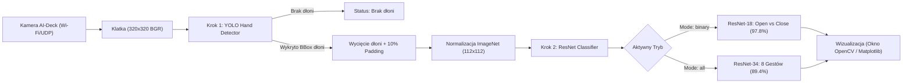

# 🚁 AI-Deck Real-Time Gesture & Hand Detector (`gesture_detector_viewer.py`)

Kompletny przewodnik po skrypcie integrującym odbiór strumienia wideo z drona Crazyflie AI-deck (NanoCockpit) z dwustopniowym potokiem sztucznej inteligencji:
1. **Detekcja dłoni w kadrze (YOLO Nano)**: Wykrywa położenie dłoni i rysuje ramkę ograniczającą (Bounding Box).
2. **Klasyfikacja gestu (ResNet-18 / ResNet-34)**: Wycina obszar dłoni i rozpoznaje gest w czasie rzeczywistym.

---

## 🏗️ 1. Architektura Dwustopniowa (Two-Stage Pipeline)



### Dlaczego dwa stopnie zamiast jednego?
- **Precyzja małych obiektów**: Dłoń na tle pomieszczenia lub podłoża z odległości 1.5–2.0 m zajmuje mały fragment klatki drona. YOLO odpowiada za niezawodne namierzenie dłoni, a ResNet skupia 100% swojej pojemności na ułożeniu palców.
- **Odporność na tło**: Wycięcie dłoni z marginesem 10% odcina zbędne otoczenie (podłogę, meble, ludzi w tle).

---

## 🚀 2. Sposoby Uruchomienia

Skrypt znajduje się w dwóch miejscach:
- W pakiecie NanoCockpit: `nanocockpit/src/client/aideck_cpx_streamer/aideck_cpx_streamer/gesture_detector_viewer.py`
- W repozytorium danych: `dane/scripts/gesture_detector_viewer.py`

### Wariant A: Lot z prawdziwym dronem AI-Deck (Wi-Fi)
Upewnij się, że komputer jest połączony z siecią Wi-Fi drona (AP drona lub wspólny router):
```bash
# 1. Tryb binarny (openhand / closehand - polecany do sterowania START/STOP):
python gesture_detector_viewer.py -host aideck.local --mode binary

# 2. Tryb wszystkich 8 gestów:
python gesture_detector_viewer.py -host aideck.local --mode all

# 3. Z klasycznym oknem Matplotlib (identycznym ze starym plt_viewer.py):
python gesture_detector_viewer.py -host aideck.local --viewer plt --mode binary
```

### Wariant B: Tryb Demonstracyjny (bez włączania drona)
Gdy dron ładuje się lub nie masz go pod ręką, możesz uruchomić odtwarzanie realnych klatek z lotu:
```bash
python gesture_detector_viewer.py --demo
```
Skrypt automatycznie załaduje 322 klatki ze zbioru walidacyjnego drona i odtworzy je w pętli z prędkością 25 FPS, wykonując pełną detekcję YOLO i klasyfikację gestów w czasie rzeczywistym.

### Wariant C: Test z kamerką wbudowaną w laptopa (Webcam)
Możesz sprawdzić modele pokazując dłonie do kamery swojego komputera:
```bash
python gesture_detector_viewer.py --source webcam
```

---

## 🎮 3. Sterowanie w Locie (Skróty Klawiszowe w Oknie)

Gdy okno podglądu jest aktywne:
| Klawisz | Działanie |
|:---:|---|
| **`m`** | **Przełącza tryb gestów w locie**: natychmiastowe przejście między `[MODE: OPEN/CLOSED]` a `[MODE: ALL 8 GESTURES]` bez restartowania aplikacji. |
| **`q`** lub **`ESC`** | Bezpieczne zakończenie strumienia i zamknięcie okien. |

---

## 🎛️ 4. Pełna Lista Opcji CLI (Flagi)

| Argument | Domyślnie | Opis |
|---|:---:|---|
| `-host` | `aideck.local` | Adres IP lub nazwa hosta drona w sieci. |
| `-port` | `5000` | Port strumienia AI-deck. |
| `--mode` | `binary` | Tryb klasyfikacji: `binary` (open/close) lub `all` (8 gestów). |
| `--viewer` | `cv2` | Silnik wyświetlania okna: `cv2` (szybki OpenCV 30+ FPS) lub `plt` (Matplotlib). |
| `--conf` | `0.35` | Próg pewności detekcji dłoni YOLO (0.0 – 1.0). |
| `--smooth` | `5` | Rozmiar bufora wygładzania predykcji w czasie (eliminuje drgania). |
| `--device` | `auto` | Akcelerator obliczeń: `auto` (MPS na Macu, CUDA na GPU, CPU). |
| `--demo` | `False` | Odtwarzanie klatek testowych ze zbioru bez łączenia z dronem. |
| `--source` | `aideck` | Źródło obrazu: `aideck`, `demo`, `webcam` lub ścieżka do pliku wideo. |
| `-save` | `None` | Opcjonalny katalog do zapisu odebranych klatek i telemetrii. |
| `--no-udp-send` | `False` | Wyłącza wysyłanie pakietów odpowiedzi UDP do drona. |

---

## 🖥️ 5. Elementy Wyświetlane na Ekranie

1. **Pasek górny**:
   - `[MODE: OPEN/CLOSED]` (żółty) lub `[MODE: ALL 8 GESTURES]` (fioletowy).
   - Licznik FPS oraz łączny czas inferencji w milisekundach (np. `FPS: 28.4 | 38ms`).
2. **Ramka Bounding Box YOLO**:
   - Rysowana bezpośrednio na kadrze wokół wykrytej dłoni.
   - Kolor ramki odpowiada rozpoznanemu gestowi:
     - 🟢 Zielony: `openhand` (Start / Otwarcie)
     - 🔴 Czerwony: `closehand` (Zatrzymanie / Pięść)
     - 🟠 Pomarańczowy: `dislike` (Lądowanie)
     - 🔵 Cyjan: `left` (Ruch w lewo)
     - 🟣 Fiolet: `right` (Ruch w prawo)
     - 🟡 Żółty: `ok` (Utrzymanie pozycji / Hover)
3. **Etykieta nad ramką**:
   - Wyświetla nazwę gestu, pewność klasyfikatora oraz pewność detektora YOLO:
     `OPENHAND: 98.4% (YOLO: 89%)`.
4. **Miniatura Picture-in-Picture (w prawym dolnym rogu)**:
   - Powiększony podgląd wycinka dłoni z ramką w kolorze gestu, pokazujący dokładnie to, co widzi model ResNet.
5. **Okno Czujnika TOF (Multi-Zone Depth)**:
   - Gdy dron przesyła dane z czujnika TOF, wyświetla się kolorowa mapa odległości w skali `TURBO`.
6. **Pozycja drona (Telemetria)**:
   - Jeśli pakiet zawiera współrzędne estymatora stanu drona, na dole wyświetlane są `Pos: [X, Y, Z] m`.

---

## 🧠 6. Modele i Domyślne Wagi

Skrypt automatycznie odnajduje najlepsze wyuczone wagi:
- **Detektor YOLO**: [`weights/yolo_hand_detector.pt`](file:///Users/michalskoczylas/Documents/studia/thesis/dane/weights/yolo_hand_detector.pt)
- **Klasyfikator Binarny**: [`weights/resnet18_binary_best.torchscript.pt`](file:///Users/michalskoczylas/Documents/studia/thesis/dane/weights/resnet18_binary_best.torchscript.pt) (ResNet-18, TorchScript, 97.80% Val Acc)
- **Klasyfikator 8 Gestów**: [`weights/resnet_all_gestures/resnet_all8_best.torchscript.pt`](file:///Users/michalskoczylas/Documents/studia/thesis/dane/weights/resnet_all_gestures/resnet_all8_best.torchscript.pt) (ResNet-34, TorchScript, 89.36% Val Acc)
