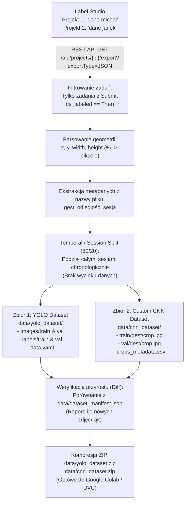

# 🔄 Jak z Label Studio (Submit) powstaje zbiór treningowy YOLO i CNN

Niniejszy dokument szczegółowo wyjaśnia, **w jaki sposób kliknięcie `Submit` w Label Studio przekłada się na gotowy zbiór treningowy** dla detektora YOLO (Etap 1) oraz klasyfikatora Custom CNN (Etap 2).

---

## 1. Różnica: Prediction vs Submit (Human Verification)

Gdy uruchamiasz `make detect` lub `make detect-yolo`, model AI wyznacza bounding boxy. Zostają one wgrane do Label Studio jako **`predictions` (propozycje)**:
- W Label Studio zadanie z samą predykcją ma status **nieukończony** (`is_labeled = False`).
- Predykcja to jedynie ułatwienie dla człowieka, aby nie musiał rysować ramki od zera.
- **Dopiero gdy człowiek (Michał lub Janek) przejrzy zadanie i kliknie niebieski przycisk `Submit` (lub `Update`), Label Studio tworzy oficjalny wpis w sekcji `annotations` danego zadania.**
- Zadania pominięte (`Skip`) lub nieotwarte **NIE** posiadają zatwierdzonej adnotacji.

---

## 2. Architektura procesu ekstrakcji

Cały proces pobierania i budowy zbioru realizuje skrypt:
```bash
make prepare-yolo-zip
# lub bezpośrednio:
python3 scripts/prepare_yolo_dataset.py --project-ids 1,2 --zip
```



---

## 3. Szczegółowy przebieg krok po kroku

### Krok 1: Odpytanie Label Studio API i łączenie projektów
Skrypt łączy się z Label Studio dla każdego skonfigurowanego projektu (`dane michal` i `dane janek`):
```python
GET http://localhost:8081/api/projects/1/export?exportType=JSON
GET http://localhost:8081/api/projects/2/export?exportType=JSON
```
- Endpoint eksportu Label Studio zwraca **wyłącznie zadania, które mają zatwierdzoną adnotację (`Submit`)**.
- Zadania, na których nikt nie kliknął `Submit`, są automatycznie pomijane przez API.
- Zadania z obu projektów są scalane. Zabezpieczenie przed duplikatami (`seen_images`) gwarantuje, że to samo zdjęcie nigdy nie zostanie policzone podwójnie.

### Krok 2: Ekstrakcja Bounding Boxów i etykiet
Dla każdego zatwierdzonego zadania:
1. Odczytywana jest lista zatwierdzonych ramek z sekcji `annotations[0]["result"]`.
2. Format Label Studio (współrzędne w procentach 0–100%) jest przeliczany na:
   - **Format YOLO (detektor):** `class_id x_center y_center width height` (znormalizowane 0.0–1.0, gdzie klasa to zawsze `0` dla `hand`).
   - **Współrzędne pikselowe (klasyfikator):** wycinany jest dokładny fragment dłoni (`crop`) z oryginalnego obrazu w pełnej rozdzielczości.
3. Etykieta gestu (`closehand`, `openhand`, `ok`, itp.) jest pobierana:
   - Z wybranej w Label Studio etykiety (jeśli zmieniono ją ręcznie),
   - Lub z nazwy pliku wideo/klatki (np. `1_4metra_closehand_2026-10-15...`).

### Krok 3: Inteligentny Split Train / Val (Session-Aware Temporal Split)
> ⚠️ **Kluczowe z punktu widzenia pracy dyplomowej i metodologii ML:**
> W wideo z drona klatki sąsiadujące (np. klatka 00010 i klatka 00020) różnią się minimalnie. Gdyby zastosować losowy split (`random.shuffle`), niemal identyczne klatki trafiłyby jednocześnie do zbioru treningowego i walidacyjnego, powodując **drastyczny wyciek danych (data leakage)** i sztucznie zawyżoną dokładność (~99%).

Nasz skrypt grupuje klatki według **unikalnych sesji nagraniowych**:
- `1_4metra_closehand_2026-10-15-14-45-08_00000.jpg` -> sesja `1_4metra_closehand_2026-10-15-14-45-08`
- Klatki w ramach sesji są sortowane chronologicznie.
- Pierwsze 80% sesji trafia do **`train`**, a ostatnie 20% do **`val`**.
- Dzięki temu model jest testowany na klatkach z innej części nagrania, co sprawdza rzeczywistą zdolność generalizacji.
- **Ten sam podział train/val jest aplikowany jednocześnie do zbioru YOLO i zbioru wycinków CNN!**

---

## 4. Co dokładnie powstaje na dysku?

### A. Zbiór dla YOLO (`data/yolo_dataset/`)
Standardowy format akceptowany przez `ultralytics` (YOLOv8, YOLO11):
```text
data/yolo_dataset/
├── data.yaml                     # Konfiguracja ścieżek i klas (nc: 1, names: ['hand'])
├── images/
│   ├── train/                    # Zdjęcia treningowe (.jpg / .png)
│   └── val/                      # Zdjęcia walidacyjne (.jpg / .png)
└── labels/
    ├── train/                    # Pliki tekstowe z ramkami (.txt)
    └── val/
```
Każdy plik `.txt` zawiera wpisy w formacie:
```text
0 0.485123 0.612450 0.084120 0.124500
```
*(klasa 0 = hand, środek X, środek Y, szerokość, wysokość znormalizowane do 1.0)*

### B. Zbiór dla Custom CNN (`data/cnn_dataset/`)
Standardowy format PyTorch `torchvision.datasets.ImageFolder`:
```text
data/cnn_dataset/
├── crops_metadata.csv            # Szczegółowa tabela ze wszystkimi wycinkami
├── train/
│   ├── closehand/                # Wycinki samej dłoni dla gestu closehand
│   │   └── crop_00001.jpg
│   ├── openhand/
│   ├── ok/
│   ├── shaka/
│   ├── v/
│   ├── dislike/
│   ├── left/
│   └── right/
└── val/
    ├── closehand/
    ├── openhand/
    └── ...
```
Plik `crops_metadata.csv` zawiera precyzyjne metadane każdego wycinka:
- `crop_filename`, `gesture`, `distance`, `split` (train/val), `orig_image`, `bbox_x`, `bbox_y`, `bbox_w`, `bbox_h`.

### C. Raport Przyrostu Danych (`data/dataset_manifest.json`)
Skrypt porównuje aktualny stan z poprzednim manifestem i wypisuje w terminalu szczegółowy diff:
```text
============================================================
📊 RAPORT PRZYROSTU DANYCH (DATASET DIFF)
============================================================
📸 Zdjęcia w zbiorze:       240 (+45 nowych od ostatniego eksportu)
✋ Wykryte/oznaczone dłonie: 258 (+48 nowych od ostatniego eksportu)
📈 Podział Train / Val:     192 train (80.0%) / 48 val (20.0%)
🏷️  Rozkład gestów w CNN:
    - closehand: 65 wycinków
    - openhand:  58 wycinków
    - ok:        42 wycinki
    ...
============================================================
```

### D. Pakiety ZIP do Chmury i Colaba
Automatycznie tworzone są spakowane archiwa:
- `data/yolo_dataset.zip` (~25 MB)
- `data/cnn_dataset.zip` (~5 MB)

Można je bezpośrednio wysłać na Dysk Google lub otworzyć w Google Colab jednym kliknięciem.
