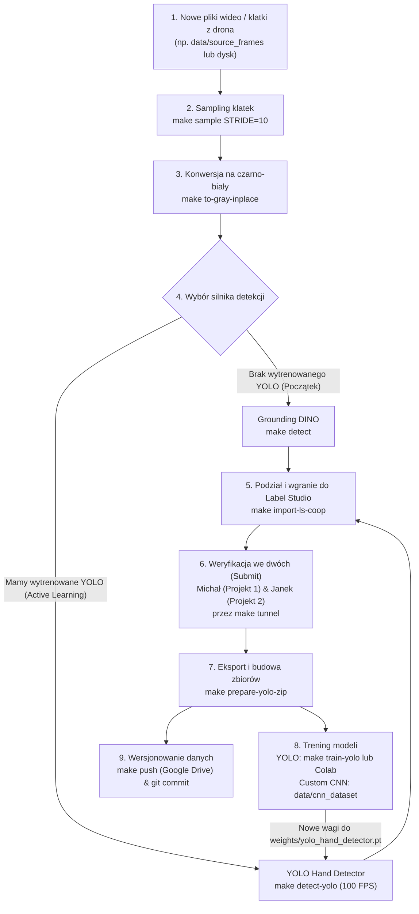

# 🚀 Kompletny Przewodnik po Potoku Danych (Pipeline Guide)

Ten dokument opisuje krok po kroku pełny cykl życia danych w projekcie: od zgrania surowych filmów z drona, przez automatyczną detekcję, kooperacyjne etykietowanie, po trening modeli i pętlę Active Learning.

---

## 🧭 Mapa Cyklu Pracy (Wizualizacja)



---

## 📌 Krok 1: Próbkowanie klatek (Sampling)

Nagrania z drona z 30 lub 60 FPS mają olbrzymią nadmiarowość. Wyciągamy co $N$-tą klatkę, aby zróżnicować zbiór.

```bash
# Wyciągnij co 10-tą klatkę z kamery RGB:
make sample STRIDE=10 CAMERA=camera_rgb

# Opcjonalnie podgląd przed wykonaniem (dry run):
make sample-dry-run STRIDE=10 CAMERA=camera_rgb
```
Pliki trafiają do katalogu `data/raw/`.

---

## 📌 Krok 2: Normalizacja klatek do czarno-białego (Grayscale)

Kamery drona mogą generować kropki wzorcowe (Bayer pattern) lub zaszumione kanały barwne. Standaryzujemy klatki na jednokanałowy, czysty czarno-biały format:

```bash
make to-gray-inplace INPUT=data/raw
```

---

## 📌 Krok 3: Autodetekcja dłoni i autolabeling

Zamiast ręcznie rysować każdą ramkę od zera, model wykonuje wstępną detekcję:

### Wariant A: Pierwsza partia (przed wytrenowaniem własnego modelu)
Używamy Grounding DINO (model zero-shot text-to-bbox):
```bash
make detect
```
*Działa wolniej (~0.5 - 1 FPS), ale nie wymaga żadnych wcześniejszych danych treningowych.*

### Wariant B: Kolejne partie (Active Learning)
Gdy masz już wytrenowany model `weights/yolo_hand_detector.pt`:
```bash
make detect-yolo
```
*Działa błyskawicznie (50–100 FPS), bezpośrednio na Twojej karcie graficznej bez Dockera!*

Wyniki zapisują się w `data/labeled/`.

---

## 📌 Krok 4: Wgranie do Label Studio i podział na 2 osoby

Aby podzielić bazę (np. 1800 klatek) po równo na Ciebie i kolegę (Janka):

```bash
make import-ls-coop
```
Skrypt automatycznie:
1. Sprawdza, które zdjęcia zostały już wcześniej zaimportowane (nie dubluje danych).
2. Dzieli nowe zdjęcia w proporcji 50/50 naprzemiennie (`interleaved`), aby obaj oznaczający mieli równy przekrój przez wszystkie gesty i odległości.
3. Wgrywa zadania wraz z wygenerowanymi ramkami (`predictions`) do:
   - Projekt 1: `dane michal`
   - Projekt 2: `dane janek`

---

## 📌 Krok 5: Weryfikacja w Label Studio (Submit)

1. Uruchom Label Studio (jeśli nie działa):
   ```bash
   make ls-up
   ```
2. Uruchom bezpieczny tunel dla kolegi:
   ```bash
   make tunnel
   ```
   *W terminalu pojawi się link `https://xxxx.trycloudflare.com`. Wyślij go Jankowi.*
3. **Zasady weryfikacji:**
   - Przejrzyj klatkę. Jeśli ramka wokół dłoni jest poprawna: kliknij **`Submit`** (skrót: `Ctrl + Enter`).
   - Jeśli ramka wymaga przesunięcia: popraw ją i kliknij **`Submit`**.
   - Jeśli model nie wykrył dłoni: narysuj prostokąt, wybierz klasę `hand` i kliknij **`Submit`**.
   - Jeśli na zdjęciu nie ma dłoni (fałszywy alarm): usuń ramkę (`Backspace`) i kliknij **`Submit`** (klatka bez ramki to tzw. background negative – uczy model nie robić fałszywych detekcji).

---

## 📌 Krok 6: Generowanie Zbiorów Treningowych (YOLO & CNN)

Gdy Ty i kolega zatwierdzicie część lub całość zadań:

```bash
make prepare-yolo-zip
```
Co robi to polecenie?
- Łączy się z Label Studio i pobiera **tylko zadania ze statusem `Submit`** z obu projektów.
- Dzieli dane na `train` (80%) i `val` (20%) według całych sesji wideo (brak wycieku danych).
- Buduje `data/yolo_dataset/` dla detektora YOLO.
- Wycina fragmenty dłoni i buduje `data/cnn_dataset/` dla klasyfikatora gestów.
- Drukuje w terminalu raport przyrostu danych (ile nowych klatek i dłoni przybyło).
- Generuje archiwa: `data/yolo_dataset.zip` oraz `data/cnn_dataset.zip`.

---

## 📌 Krok 7: Trening Modeli

### Trening Detektora Dłoni (Etap 1 - YOLO Nano)
- **Lokalnie (NVIDIA RTX / Mac Apple Silicon):**
  ```bash
  make train-yolo
  ```
  *(Automatycznie wykrywa akcelerację CUDA `cuda:0` na PC lub MPS na Macu).*
- **W Google Colab (darmowe GPU T4/A100):**
  1. Otwórz plik `notebooks/train_yolo_colab.ipynb` w Google Colab.
  2. Wgraj `yolo_dataset.zip` na swój Dysk Google.
  3. Uruchom komórki w Colabie – model wytrenuje się w kilkanaście minut i odeśle `best.pt` na Twój Dysk Google.

Po zakończeniu treningu zapisz wagi w projekcie jako:
```text
weights/yolo_hand_detector.pt
```

### Trening Klasyfikatora Gestów (Etap 2 - Custom CNN / ResNet)
Zbiór wycinków dłoni znajduje się w `data/cnn_dataset/` w standardzie PyTorch `ImageFolder`. Każdy podkatalog odpowiada jednej klasie gestu (`closehand`, `openhand`, `ok`, `shaka`, `v`, `dislike`, `left`, `right`).

---

## 📌 Krok 8: Wersjonowanie i Bezpieczeństwo Danych (DVC + Git)

Aby zachować pełną powtarzalność badań naukowych do pracy inżynierskiej:

1. **Wysyłka dużych zbiorów danych na Dysk Google (DVC):**
   ```bash
   make push
   ```
2. **Zapis kodu, konfiguracji i wskaźników w Git:**
   ```bash
   git add params.yaml dvc.lock data/dataset_manifest.json
   git commit -m "Aktualizacja zbioru danych po weryfikacji w Label Studio"
   git push
   ```
